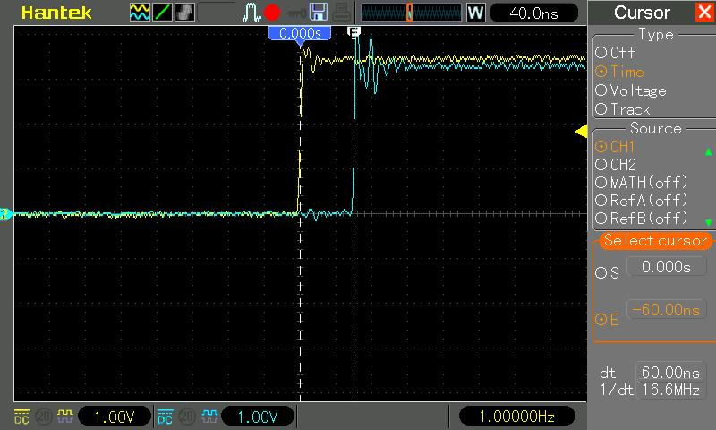

| Supported Targets | ESP32-P4 | ESP32-S31 |
| ----------------- | -------- | --------- |

# Time Synchronization over PTP

## Overview

This example demonstrates Precision Time Protocol (PTP) time synchronization over Ethernet. It initializes Ethernet, starts a PTP daemon (the [`espressif/esp_ptp`](../../esp_ptp) component, ported from [NuttX](https://github.com/apache/nuttx-apps/tree/master/netutils/ptpd)), and showcases synchronization accuracy by toggling a GPIO pin.

The PTP protocol is transported over **Ethernet at Layer 2 (L2)**, following Annex F of IEEE 1588-2008 (PTPv2). **Timestamps are provided by the internal Ethernet MAC (EMAC)** and attached to frames in hardware. These timestamps are passed to software through the **L2 TAP** interface.

Run the example on at least two ESP32-P4 (or ESP32-S31) boards: one **master** and one **slave**. Both devices start toggling a GPIO pin once they are synchronized. Measuring alignment of the rising edges with an oscilloscope shows the synchronization precision. Pulse width and toggle frequency can be configured with ``CONFIG_EXAMPLE_PTP_PULSE_WIDTH_NS``.

## How to use example

### Hardware Required

* Two official Ethernet-capable boards — [ESP32-P4-Function-EV-Board](https://docs.espressif.com/projects/esp-dev-kits/en/latest/esp32p4/esp32-p4-function-ev-board/user_guide.html) is recommended.

* An oscilloscope to compare GPIO pulse alignment between master and slave.

#### Pin Assignment

This example uses the default GPIO configuration from `ETH_ESP32_EMAC_DEFAULT_CONFIG` for the selected target. Configure the Ethernet PHY and related options through [ethernet_init](https://components.espressif.com/components/espressif/ethernet_init/) in menuconfig.

### Configure the project

```
idf.py menuconfig
```

Configure:

* **PTP Pulse GPIO Pin**: GPIO used for pulse toggling.
* **Pulse Width (ns)**: Pulse width in nanoseconds (callback pulse source).
* **PTP Daemon Configuration**: Master or slave and associated parameters. Enable ``PTP Client delay requests`` for more precise synchronization.
* **Ethernet**: PHY type and board-specific Ethernet options (see `ethernet_init`).

### Build, Flash, and Run

Build and flash both boards, then open the serial monitor:

```
idf.py -p PORT build flash monitor
```

(Replace PORT with the serial port.)

(To exit the serial monitor, type ``Ctrl-]``.)

See the [Getting Started Guide](https://docs.espressif.com/projects/esp-idf/en/latest/get-started/index.html) for full steps to configure ESP-IDF.

## Example Output

### PTP Slave

```
I (10107) ptpd: Got announce packet, seq 3120

I (10107) ptpd: Switching to better PTP time source

I (10107) gpio: GPIO[20]| InputEn: 0| OutputEn: 1| OpenDrain: 0| Pullup: 0| Pulldown: 0| Intr:0
I (10107) ptpd: Got sync packet, seq 31198

I (10107) ptpd: Waiting for follow-up

I (10107) ptpd: Got follow-up packet, seq 31198

I (10137) ptpd: Local time: 7.633787680, remote time 31996.904013440

I (10137) ptpd: Jumped to timestamp 31996.935345720 s

I (9866) ptp_example: Starting Pulse train

I (9866) ptp_example: curr time: 230.312127120

I (9876) ptp_example: next time: 231.500000000

I (9876) main_task: Returned from app_main()
I (10836) ptpd: Got sync packet, seq 229

I (10836) ptpd: Waiting for follow-up

I (10836) ptpd: Got follow-up packet, seq 229

I (10846) ptpd: Local time: 231.286076880, remote time 231.286195640

I (10846) ptpd: remote_delta_ns 231286195640, local_delta_ns 231286076880, tick_diff 118760

I (10856) ptpd: offset_ns 118760, adj 130636, drift_acc 11876

...

I (59686) ptpd: Waiting for follow-up

I (59686) ptpd: Got follow-up packet, seq 277

I (59696) ptpd: Local time: 280.136196920, remote time 280.136196120

I (59696) ptpd: remote_delta_ns 1030000440, local_delta_ns 1030000440, tick_diff 0

I (59706) ptpd: offset_ns -186, adj 2, drift_acc 188

I (59716) ptpd: Sent delay req, seq 19

I (59716) ptpd: Got delay-resp, seq 19

I (59726) ptpd: Path delay: 847 ns (avg: 626 ns)
```

### Synchronization Pulses

The figure below shows synchronization pulses generated by the master and slave, measured on an oscilloscope.



## Troubleshooting

* Confirm both boards use a PHY supported by `ethernet_init` and that L2 TAP is enabled (`CONFIG_ESP_NETIF_L2_TAP=y`).
* For tighter sync, enable PTP client delay requests.
* See common Ethernet troubleshooting in the [ESP-IDF Ethernet examples](https://github.com/espressif/esp-idf/tree/master/examples/ethernet).

(For technical queries, please open an [issue](https://github.com/espressif/esp-ptp/issues) on GitHub.)
